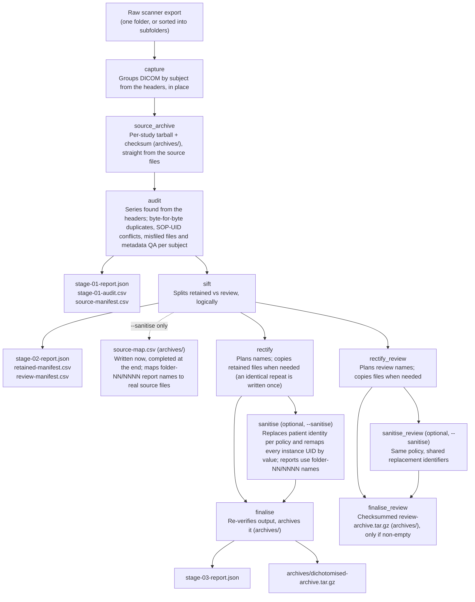

# Workflow

**TL;DR:** Capture, archive, audit, sort, optionally sanitise, then verify and archive each study.

One command runs the full pipeline, in order:

1. **capture**: groups the source directory's DICOM files by
   `(PatientID, StudyInstanceUID)` from their own headers, never from folder
   names. Nothing is copied yet; every file stays exactly where the export
   left it.
2. **source_archive**: archives each subject's untouched DICOM files,
   straight from the source directory, with a checksum. Capture reads headers
   first; the original files are not modified. Digests gathered during archiving
   are reused to check copied files and detect changes to the source.
3. **audit**: flags duplicates (a file is a duplicate only if it is a
   byte-for-byte copy of another file in the same folder; the numerically
   first copy, `2.dcm` before `10.dcm`, is kept), files that share a
   SOP Instance UID with a file whose bytes differ (a metadata error, sent to
   review as `sop_conflict`, never called a duplicate; checked across the
   whole study), files sitting in the wrong series folder, and inconsistent patient,
   study, or series metadata within a series. Series come from the headers, not from the
   layout: a folder of one series is checked for strays, and a folder that holds several
   series (a whole study exported into one folder, with or without a `.dcm` extension) is
   audited series by series (three or more series, or two when most files are named after
   their own SOP Instance UID; two series under other names still read as one series plus
   strays). The CLI prints a Rich inventory table
   followed by a NOTES section that explains each finding in plain language
   (for example which file belongs to which series, and which files repeat
   which), and the reports include the same notes and a spreadsheet-friendly
   CSV.
   Byte-identical copies in *different* folders are not flagged: they are
   not duplicates by this definition, and they share one output filename, so
   they end up as a single file in the sorted tree.
4. **sift**: splits files into `retained` and `review`, logically, before
   the final archive is ever built, so a flagged file is never silently
   included in the archive you share. This is a classification step only
   (no files move yet). You do not need to delete and re-export a whole
   series to exclude one bad file: `sift` already excludes it, and the
   untouched source archive (in `archives/`) remains the reference if you
   ever need the original file back.
5. **rectify**: plans a sorted, clearly named tree:
   `<series number>-<series description>/<series>_<instance>_<SOP instance UID>_e<echo>.dcm`.
   The SOP Instance UID is the identifier DICOM guarantees to be unique per
   file, so a name never depends on instance numbers being unique. The echo
   number comes from the `EchoNumbers` header or, for Enhanced MR files, from
   the per-frame groups. When the chosen sanitisation policy regenerates the
   UID, the file is renamed to match the new header value. Policies such as
   `retain` leave the original UID in place.
   Without sanitisation, files are copied into this tree. A sanitised run
   writes directly from the source unless `--keep-working-files` requests
   the intermediate rectified copies. A byte-identical repeat is written once. Review files are named the
   same way (surfacing what a misfiled or duplicate file's own metadata claims, even when that metadata
   is wrong),
   and are then always archived with a checksum into `archives/` as their own
   `review-archive`, independent of `--keep-working-files`.
6. **sanitise** *(optional, `--sanitise`)*: replaces patient identity
   according to a chosen policy and, for every policy that regenerates `SOPInstanceUID`, remaps every
   remaining instance UID by value, so an image's SOP Instance UID and the references that point at it
   stay in step (a policy that reissues only some UIDs updates the references to those and leaves
   the rest); see [Sanitisation](usage.md#sanitisation). When
   used, the `review-archive` uses the same policy and replacement identifiers
   as the main archive. Folder names follow the policy: a withheld series
   description leaves just the series number, and a replaced one is used as
   given. Policies that retain descriptive fields can retain identifying text
   in those fields and folder names.
7. **finalise**: independently checks output paths and reads finished files
   back. Unsanitised copies are compared with source digests; sanitised image
   pixels and interpretation fields are compared with input fingerprints.
   The resulting archive receives a checksum. These checks do not establish
   compliance with a DICOM confidentiality profile.

It is a single end-to-end pipeline, kept simple to read, debug and extend; there is
no separate stage-by-stage command.

## Workflow diagram

**TL;DR:** Retained and review files follow separate archive paths.

[Back to the README](../README.md)
